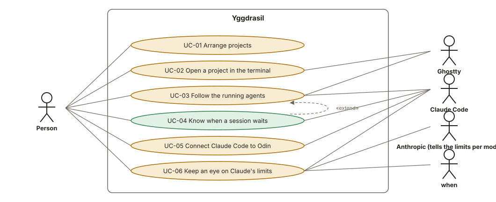

# Spec status

Generated by `./x spec` from the use cases and the test results: **21 of 44** acceptance criteria met. 🟩 all met · 🟨 some · 🟥 none. Open `status.html` locally for the same as a page.

|     | Use case                                                             | Met  |
| --- | -------------------------------------------------------------------- | :--: |
| 🟨  | [UC-01 Arrange projects](use-cases/UC-01-projects.md)                | 6/7  |
| 🟨  | [UC-02 Open a project in the terminal](use-cases/UC-02-open.md)      | 3/12 |
| 🟨  | [UC-03 Follow the running agents](use-cases/UC-03-follow.md)         | 2/9  |
| 🟩  | [UC-04 Know when a session waits](use-cases/UC-04-waiting.md)        | 3/3  |
| 🟨  | [UC-05 Connect Claude Code to Yggdrasil](use-cases/UC-05-connect.md) | 3/5  |

|     | Requirement                                     | Met |
| --- | ----------------------------------------------- | :-: |
| 🟩  | [FR-01 Projects](requirements.md)               | 2/2 |
| 🟨  | [FR-02 Groups](requirements.md)                 | 2/3 |
| 🟩  | [FR-03 Kept tree](requirements.md)              | 2/2 |
| 🟥  | [FR-04 Open](requirements.md)                   | 0/5 |
| 🟥  | [FR-05 Resume](requirements.md)                 | 0/1 |
| 🟩  | [FR-06 Permission](requirements.md)             | 1/1 |
| 🟥  | [FR-07 To the terminal](requirements.md)        | 0/1 |
| 🟨  | [FR-17 Terminal in the window](requirements.md) | 2/4 |
| 🟥  | [FR-18 Quit asks](requirements.md)              | 0/1 |
| 🟨  | [FR-08 Live sessions](requirements.md)          | 1/4 |
| 🟥  | [FR-09 Agents](requirements.md)                 | 0/1 |
| 🟥  | [FR-10 Ended sessions](requirements.md)         | 0/2 |
| 🟩  | [FR-11 Earlier sessions](requirements.md)       | 1/1 |
| 🟥  | [FR-12 Other sessions](requirements.md)         | 0/1 |
| 🟩  | [FR-13 Waiting notification](requirements.md)   | 3/3 |
| 🟨  | [FR-14 Connect](requirements.md)                | 1/2 |
| 🟥  | [FR-15 Sandbox sessions](requirements.md)       | 0/1 |
| 🟩  | [FR-16 Settings kept](requirements.md)          | 2/2 |
| 🟩  | [NFR-01 Nothing private kept](requirements.md)  | 1/1 |
| 🟩  | [NFR-02 Claude never held up](requirements.md)  | 2/2 |
| 🟩  | [NFR-03 No network](requirements.md)            | 1/1 |
| 🟥  | [NFR-04 Resource use](requirements.md)          | 0/1 |
| 🟥  | [NFR-05 Look](requirements.md)                  | 0/1 |
| 🟥  | [NFR-06 Interface language](requirements.md)    | 0/1 |
| 🟥  | [NFR-07 Platform](requirements.md)              | 0/1 |

Traceability: 36 of 36 use-case criteria trace to a requirement.

## Next hand-check run (25 checks, 23 due)

Every criterion without a test, and those test-plan.md says need a hand check too, for the next run on the device: copy the table into [test-journal.md](test-journal.md) as a new run on top and fill in *Result* (✓, ✗, or — when not run) and *Seen*. Due ones first: never checked, failed, or last checked before the last release. How: [test-plan.md](test-plan.md).

| Criterion | Due           | Last         | Result | Seen |
| --------- | ------------- | ------------ | :----: | ---- |
| UC-01.3   | never checked | —            |        |      |
| UC-02.1   | never checked | —            |        |      |
| UC-02.2   | never checked | —            |        |      |
| UC-02.3   | never checked | —            |        |      |
| UC-02.4   | never checked | —            |        |      |
| UC-02.5   | never checked | —            |        |      |
| UC-02.9   | never checked | —            |        |      |
| UC-02.10  | never checked | —            |        |      |
| UC-02.11  | never checked | —            |        |      |
| UC-02.12  | never checked | —            |        |      |
| UC-03.1   | never checked | —            |        |      |
| UC-03.2   | never checked | —            |        |      |
| UC-03.3   | never checked | —            |        |      |
| UC-03.4   | never checked | —            |        |      |
| UC-03.6   | never checked | —            |        |      |
| UC-03.7   | never checked | —            |        |      |
| UC-03.9   | never checked | —            |        |      |
| UC-05.1   | never checked | —            |        |      |
| UC-05.3   | never checked | —            |        |      |
| NFR-04.1  | never checked | —            |        |      |
| NFR-05.1  | never checked | —            |        |      |
| NFR-06.1  | never checked | —            |        |      |
| NFR-07.1  | never checked | —            |        |      |
| UC-02.7   |               | ✓ 2026-10-30 |        |      |
| UC-02.8   |               | ✓ 2026-10-30 |        |      |

## Use-case diagram

## 🟨 UC-01 Arrange projects

- 🟩 **UC-01.1** Given an empty tree, when Alice adds the folder *~/code/vesta*, then the tree shows the project *vesta* at its top level. *(test: tree::tests::uc_01_1_a_folder_becomes_a_project_at_the_top)*
- 🟩 **UC-01.2** Given the project *vesta* in the tree, when Alice adds the same folder again, then no second project appears, and *vesta* is selected. *(test: tree::tests::uc_01_2_a_folder_is_added_once)*
- 🟥 **UC-01.3** Given the projects *vesta* and *moneta*, when Alice makes the group *Apps* and drags both into it, then the tree shows *Apps* with *vesta* and *moneta* inside, in the order she dropped them; a group dragged into another group goes inside it the same way. *(the test passes, the hand check is missing: tree::tests::uc_01_3_projects_and_groups_go_into_groups_in_order)*
- 🟩 **UC-01.4** Given a tree with groups and projects, when Yggdrasil is quit and started again, then the tree is exactly as it was. *(test: tree::tests::uc_01_4_the_tree_comes_back_after_a_restart)*
- 🟩 **UC-01.5** Given the group *Apps* holding *vesta* inside the group *Work*, when Alice removes *Apps*, then *vesta* is in *Work* where *Apps* was; the folders on the disk are untouched. *(test: tree::tests::uc_01_5_a_removed_group_leaves_its_contents_in_its_place)*
- 🟩 **UC-01.6** Given the project *old*, when its folder is deleted on the disk, then *old* stays in the tree, marked as missing, until Alice removes it. *(test: tree::tests::uc_01_6_a_project_whose_folder_is_gone_is_marked_missing)*
- 🟩 **UC-01.7** Given the group *Apps*, when Alice renames it to *Mobile*, then the tree shows *Mobile* in the same place with the same contents. *(test: tree::tests::uc_01_7_a_renamed_group_keeps_its_place_and_contents)*

## 🟨 UC-02 Open a project in the terminal

- 🟥 **UC-02.1** Given the project *vesta*, when Alice chooses *Terminal*, then the pane shows a new terminal whose working folder is *vesta*'s folder, it takes what she types, and it is listed under *vesta* in the tree as *Terminal*. *(the test passes, the hand check is missing: panes::tests::uc_02_1_a_new_terminal_is_shown)*
- 🟥 **UC-02.2** Given the project *vesta*, when Alice chooses *Claude*, then the pane shows a new terminal in *vesta*'s folder with Claude Code started in it, and its session shows under *vesta*. *(the test passes, the hand check is missing: ghostty::tests::uc_02_2_claude_is_started_in_the_new_terminal)*
- 🟥 **UC-02.3** Given the project *vesta*, when Alice chooses *Claude in a sandbox*, then the pane shows a new terminal in *vesta*'s folder with Claude Code started in a sandbox of the project. *(the test passes, the hand check is missing: ghostty::tests::uc_02_3_claude_is_started_in_a_sandbox_of_the_project)*
- 🟥 **UC-02.4** Given an earlier session of *vesta*, when Alice chooses *Resume* on it, then the pane shows a new terminal in *vesta*'s folder with that session continued. *(the test passes, the hand check is missing: ghostty::tests::uc_02_4_an_earlier_session_is_continued)*
- 🟥 **UC-02.5** Given Ghostty isn't running, when Alice chooses *Open in Ghostty* and then *Open Terminal* on *vesta*, then Ghostty starts and opens a tab in *vesta*'s folder.
- 🟩 **UC-02.6** Given Yggdrasil isn't allowed to control Ghostty, when Alice chooses *Open in Ghostty* and then *Open Terminal*, then Yggdrasil says that it needs the permission and opens the system settings where it is given. *(test: ghostty::tests::uc_02_6_a_missing_permission_is_recognized)*
- 🟩 **UC-02.7** Given Yggdrasil's window on the Mac with no terminal open, then its right side shows a terminal with Alice's shell in her home folder, in the font and colors of her Ghostty settings; when she clicks into it, it takes what she types, and when she clicks into the tree, the tree takes the keys again. *(test: ghostty_ffi::tests::uc_02_7_the_structs_match_ghostty_h; checked by hand: 2026-10-30, run 2 · b146c8d (./x run) on the Mac: Typing, Ctrl-C and Ctrl-L work; no problems seen.)*
- 🟩 **UC-02.8** Given the terminal pane and Alice's keyboard set to U.S. International, when she types " and then o, then ö appears once, and while only the " is typed it shows at the cursor without being sent; an emoji picked in the character viewer arrives as that emoji. *(checked by hand: 2026-10-30, run 3 · b146c8d (./x run) on the Mac: Run 2's result, under the criterion without input methods (later.md L-4): " and then o gives ö; emoji arrive.)*
- 🟥 **UC-02.9** Given the project *vesta*, when Alice chooses *Open in Ghostty* in its menu and then *Open Terminal*, *Start Claude* or *Start Claude in a Sandbox*, then Ghostty opens a new tab in *vesta*'s folder, with Claude Code started in it for the last two. *(the test passes, the hand check is missing: ghostty::tests::uc_02_9_a_ghostty_tab_opens_in_the_projects_folder, ghostty::tests::uc_02_9_claude_starts_in_a_sandbox_in_the_ghostty_tab, ghostty::tests::uc_02_9_claude_starts_in_the_ghostty_tab)*
- 🟥 **UC-02.10** Given terminals of *moneta* and then *vesta* in the pane, *vesta*'s shown, when Alice types `exit` in it, then *vesta*'s terminal closes, leaves the tree, and *moneta*'s shows; when the last terminal closes, the pane shows a shell in her home folder. *(the test passes, the hand check is missing: panes::tests::uc_02_10_closing_the_shown_terminal_shows_the_one_shown_before)*
- 🟥 **UC-02.11** Given terminals of *vesta* and *moneta* in the pane, then ⌘1 and ⌘2 show them in the tree's order, ⌘T opens another terminal in the project of the one shown, and ⌘W closes the one shown; while a program runs in it, ⌘W asks first, and *Cancel* keeps it running.
- 🟥 **UC-02.12** Given Claude running in a terminal of the pane, when Alice quits Yggdrasil with ⌘Q or by closing its window, then Yggdrasil asks first and says how many terminals run a program; *Cancel* keeps everything running and *Quit* ends them; with only shells waiting at their prompt, Yggdrasil quits without asking.

## 🟨 UC-03 Follow the running agents

- 🟥 **UC-03.1** Given a session of *vesta* that Alice has just given a prompt, then within 2 seconds the tree shows the session under *vesta* as *working*; when Claude finishes its answer, as *idle*. *(the test passes, the hand check is missing: events::tests::uc_03_1_a_prompt_makes_a_session_working_and_its_answer_idle, watch::tests::uc_03_1_a_new_line_from_the_hook_is_noticed_within_2_seconds)*
- 🟥 **UC-03.2** Given a working session, when Claude asks for a permission or for Alice's answer, then the tree shows it as *waiting* within 2 seconds; when Alice answers and Claude goes on, as *working* again. *(the test passes, the hand check is missing: events::tests::uc_03_2_a_permission_request_makes_it_waiting_until_claude_goes_on)*
- 🟥 **UC-03.3** Given a working session, when it starts a subagent of the kind *Explore*, then the tree shows *Explore* under the session within 2 seconds; when the agent finishes, it disappears from under the session. *(the test passes, the hand check is missing: events::tests::uc_03_3_agents_show_while_they_run)*
- 🟥 **UC-03.4** Given a running session, when its Claude process ends (the person quits it, closes the tab, or it crashes), then the session leaves the running sessions within 2 seconds and is listed among the earlier sessions. *(the test passes, the hand check is missing: events::tests::uc_03_4_a_session_ends_with_its_end_or_its_process, system::tests::uc_03_4_a_process_that_ended_is_seen_as_gone)*
- 🟩 **UC-03.5** Given Claude started in a terminal Yggdrasil didn't open, in the folder of the project *vesta* or a folder inside it, then its session shows under *vesta* like the others. *(test: tree::tests::uc_03_5_a_folder_belongs_to_the_deepest_project_it_is_in)*
- 🟥 **UC-03.6** Given Claude running in a sandbox of the project *vesta*, then its session shows under *vesta*, marked as in a sandbox, with its state and agents like the others; when the sandbox stops, the session shows as ended. *(the test passes, the hand check is missing: events::tests::uc_03_6_a_sandbox_session_ends_when_its_sandbox_stops, sbx::tests::uc_03_6_sandboxes_and_their_workspace)*
- 🟥 **UC-03.7** Given a session in a terminal of the pane, when Alice clicks it in the tree, then the pane shows that terminal and it takes what she types; for a session in a Ghostty tab Yggdrasil opened, that tab comes to the front; for a session in a terminal Yggdrasil doesn't know, Ghostty comes to the front and Yggdrasil says it can't tell which tab. *(the test passes, the hand check is missing: ghostty::tests::uc_03_7_the_sessions_terminal_is_found_by_its_tty, panes::tests::uc_03_7_a_session_is_found_in_its_terminal_by_device, panes::tests::uc_03_7_sandbox_sessions_are_found_in_the_sandbox_terminals_of_their_project_in_order)*
- 🟩 **UC-03.8** Given earlier sessions of *vesta*, then they are listed under *vesta*'s running sessions, newest first, each with when it was last active, at most 10. *(test: history::tests::uc_03_8_earlier_sessions_newest_first_at_most_10)*
- 🟥 **UC-03.9** Given a session started in a folder that is in no project, then it shows under *Other sessions* at the end of the tree.

## 🟩 UC-04 Know when a session waits

- 🟩 **UC-04.1** Given a working session of *vesta* in a terminal that isn't in front, when Claude asks for a permission, then within 2 seconds a notification says that *vesta*'s session waits for a permission; clicking the notification brings the session's terminal to the front. *(test: events::tests::uc_04_1_a_session_starting_to_wait_brings_a_notification)*
- 🟩 **UC-04.2** Given a session whose terminal is in front (shown in the pane of Yggdrasil's window in front, or its Ghostty tab in front), when it starts waiting, then no notification comes. *(test: events::tests::uc_04_2_no_notification_while_its_terminal_is_in_front)*
- 🟩 **UC-04.3** Given notifications turned off in Yggdrasil's settings, when a session starts waiting, then no notification comes, and the tree still shows it as *waiting*. *(test: events::tests::uc_04_3_no_notification_when_turned_off)*

## 🟨 UC-05 Connect Claude Code to Yggdrasil

- 🟥 **UC-05.1** Given Claude Code's user settings without Yggdrasil, when Alice chooses *Connect*, then Claude sessions started afterwards on the Mac report their steps to Yggdrasil (seen in UC-03.1). *(the test passes, the hand check is missing: hook::tests::uc_05_1_connecting_adds_the_hook_to_every_step)*
- 🟩 **UC-05.2** Given Claude Code's settings with Alice's own settings and hooks, when Yggdrasil connects or disconnects, then her own settings and hooks are unchanged, in the same order. *(test: hook::tests::uc_05_2_the_persons_own_settings_and_hooks_stay_in_their_order)*
- 🟥 **UC-05.3** Given the project *vesta* with *Sandbox sessions* turned on, when Claude runs in a sandbox of *vesta*, then its session reports its steps to Yggdrasil (seen in UC-03.6), while sessions of *vesta* on the Mac aren't reported twice. *(the test passes, the hand check is missing: hook::tests::uc_05_3_sandbox_and_mac_each_write_once)*
- 🟩 **UC-05.4** Given Yggdrasil connected, when Alice chooses *Disconnect* (and turns *Sandbox sessions* off), then Claude's settings are exactly as before connecting. *(test: hook::tests::uc_05_4_disconnecting_leaves_the_settings_as_before)*
- 🟩 **UC-05.5** Given Claude's settings file isn't valid, when Alice chooses *Connect*, then Yggdrasil says the file can't be read and where it is, and changes nothing. *(test: hook::tests::uc_05_5_a_broken_settings_file_is_left_alone)*

## 🟩 NFR-01 Nothing private kept

- 🟩 **NFR-01.1** Given Claude reports a prompt, a tool use with a file's contents, and a notification with a message, then the lines it leaves for Yggdrasil hold the kind of step, the ids, the folder and the time, but none of the prompt, the file's contents, the command or the message. *(test: hook::tests::nfr_01_1_no_prompt_content_command_or_message_is_kept)*

## 🟩 NFR-02 Claude never held up

- 🟩 **NFR-02.1** Given Yggdrasil isn't running and its folders don't exist, when Claude reports a step, then the report finishes without an error and Claude goes on. *(test: hook::tests::nfr_02_1_the_hook_never_fails_claude)*
- 🟩 **NFR-02.2** Given a step with a large report (a file of 1 MB written), when it is reported, then the report takes less than 100 milliseconds. *(test: hook::tests::nfr_02_2_a_large_report_takes_less_than_100_ms)*

## 🟩 NFR-03 No network

- 🟩 **NFR-03.1** Given the libraries Yggdrasil contains and its code, then none of them can open a network connection. *(test: nfr_03_1_no_library_or_code_can_open_a_connection)*

## 🟥 NFR-04 Resource use

- 🟥 **NFR-04.1** Given Yggdrasil open on the Mac with no session running for 10 minutes, then it used less than 1 second of CPU in that time.

## 🟥 NFR-05 Look

- 🟥 **NFR-05.1** Given the app on the Mac, then its window uses dark surfaces with the ember accent, and its settings open in a settings window with ⌘,.

## 🟥 NFR-06 Interface language

- 🟥 **NFR-06.1** Given the interface, then its texts are in US English and use the glossary's terms.

## 🟥 NFR-07 Platform

- 🟥 **NFR-07.1** Given the current macOS on the test Mac and Ghostty 1.4, then the app runs and its hand checks run on it.
